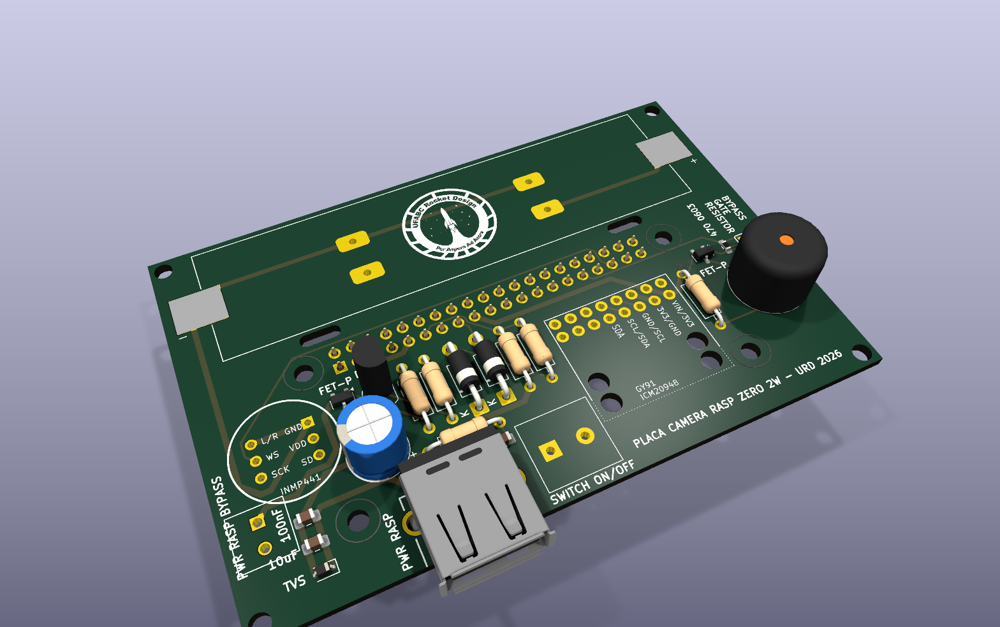
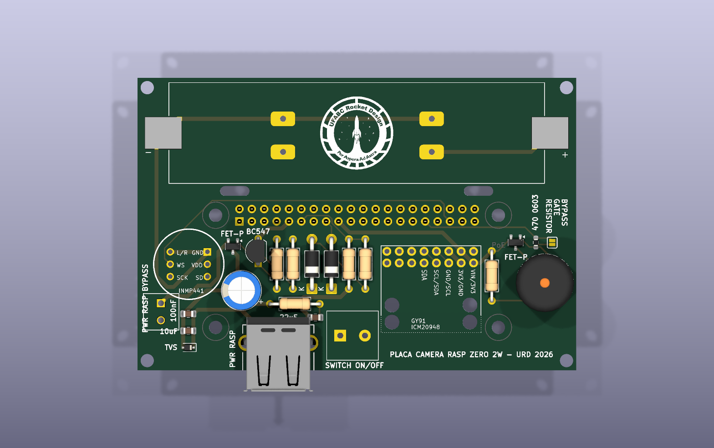
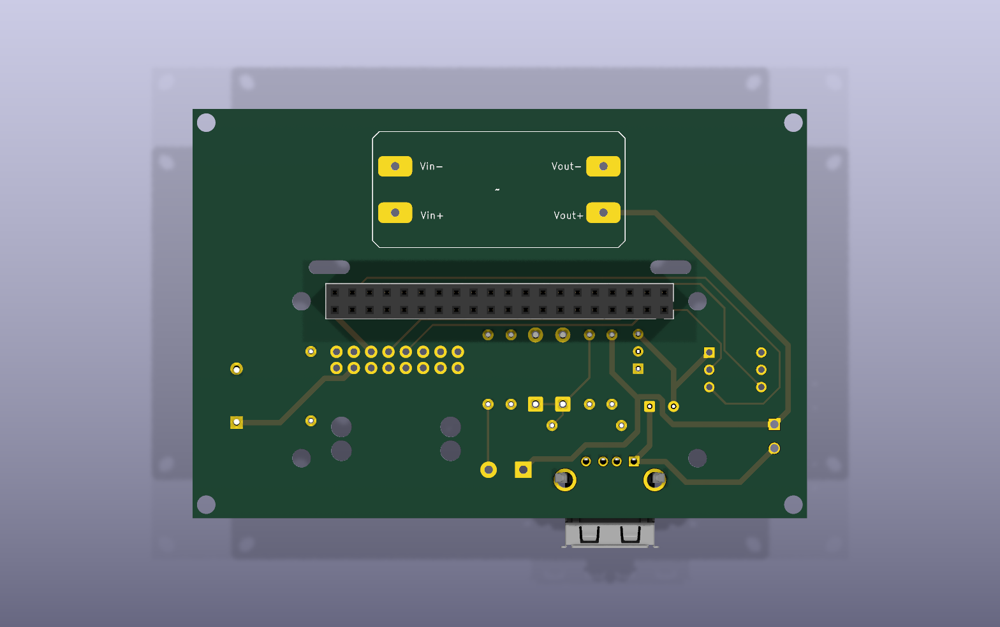

# CAMERA_RASP

Placa de interface que se encaixa no **Raspberry Pi Zero 2W** para formar a câmera de bordo do foguete ([RaspCAM](https://github.com/jcardozo08/RaspCAM)). Ela cuida do **gerenciamento de energia**, dos **sensores de telemetria** e dos **avisos sonoros**, deixando o Raspberry livre para gravar o vídeo.

## Destaques

- Encaixe direto no header **2x20** do Raspberry Pi
- **Gerenciamento de energia:** chave ON/OFF, chaveamento por MOSFET P controlado pelo Raspberry (desligamento seguro), diodos Schottky 1N5819 para proteção/ORing e bypass de alimentação
- **Telemetria:** conector para IMU/barômetro (GY-91 / ICM-20948) e microfone I2S INMP441
- **Avisos sonoros** por buzzer acionado com transistor
- Porta **USB-A** para a câmera e proteções ESD/TVS

| Topo | Base |
|:---:|:---:|
|  |  |

## Arquivos

- `CAMERA_RASP.kicad_sch`: esquemático ([ver em SVG](images/schematic.svg))
- `CAMERA_RASP.kicad_pcb`: layout da placa ([ver em SVG](images/layout.svg))
- `CAMERA_RASP.step`: modelo 3D

**Ferramenta:** KiCad
